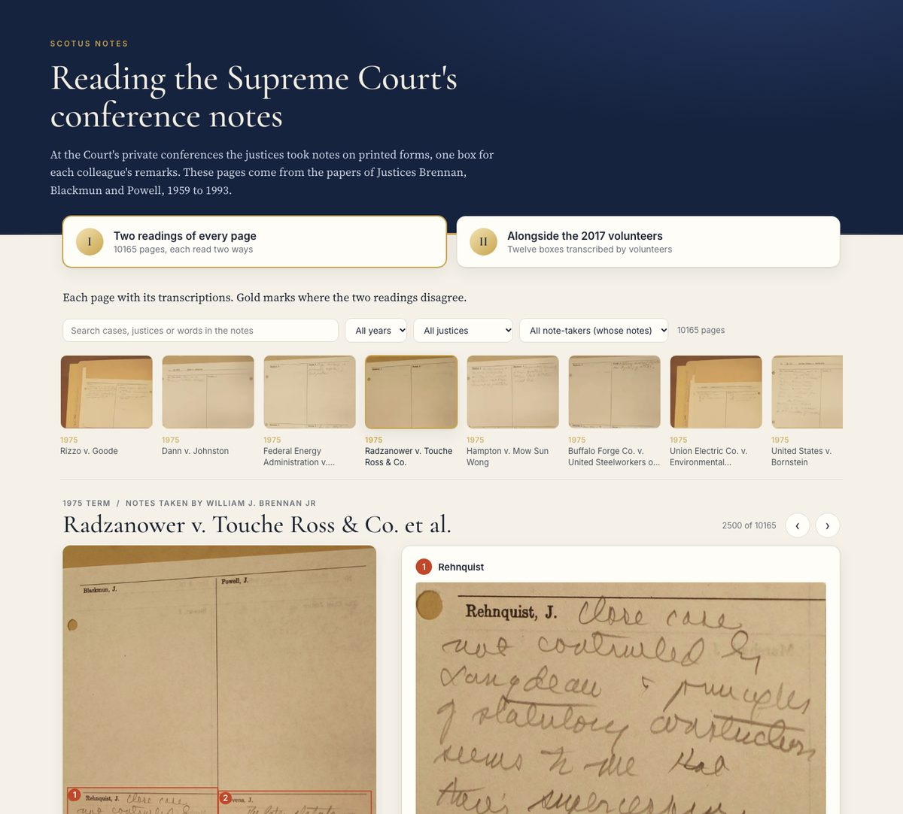

# Reading the Supreme Court's conference notes

At the Court's private conferences the justices took notes on printed forms, one box for each colleague's remarks.
These pages come from the papers of Justices Brennan, Blackmun and Powell, 1946 to 1993, with a transcription of
everything written on them.

### → [Open the showcase](https://vedpiyush93-stack.github.io/SCOTUS_NOTES/)

- **At a glance**: the whole collection in numbers and interactive charts (pages by term, who sat at conference,
  pages naming each justice)
- **10,263 pages with marked boxes**, each read two ways: from the whole page, and from each box on its own
- **2,872 pages without marked boxes**, each read as a whole; 2,855 of them also found and read box by box
- **Twelve boxes** alongside the transcriptions Zooniverse volunteers made in 2017
- **Search** by case, justice or any word in the notes; **filter** by year, justice and note-taker
- Click any image to zoom; arrow keys move between pages; works on phones

Page images: the SCOTUS Notes project on Zooniverse.
